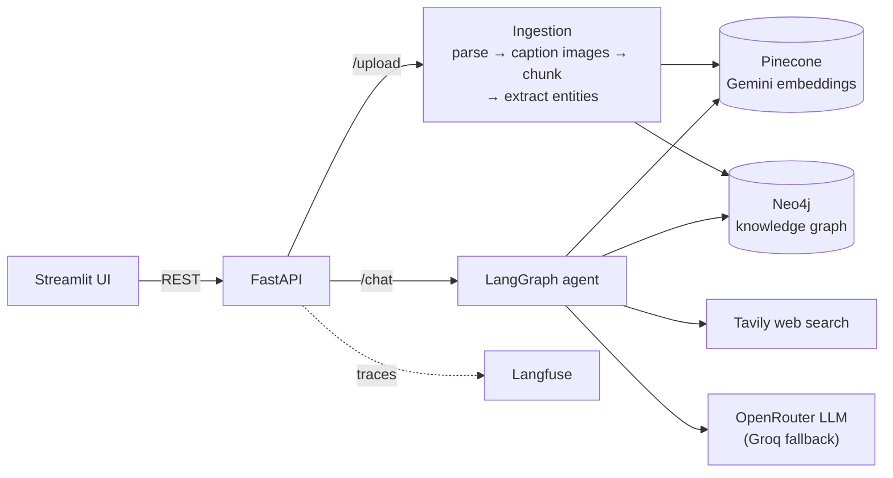
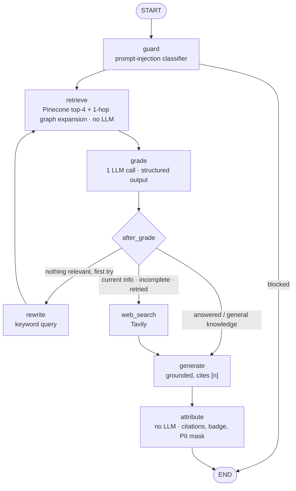

# Multimodal Agentic RAG Chatbot

A chatbot that answers questions from your **PDF and DOCX documents, including the facts that only exist inside their
charts and diagrams**, falls back to **live web search** or the **model's own knowledge** when the documents can't
answer, **follows connections across documents** through a knowledge graph, and tells you exactly which source every
claim came from.

Built as an end-to-end GenAI system, not a notebook: a LangGraph agent with a corrective retrieval loop and hybrid
vector + graph retrieval, a FastAPI backend, a Streamlit UI, Langfuse tracing, an evaluation harness, and governance
controls (prompt-injection guard, PII masking, audit log), all running in Docker.

## What it does

- **Reads charts, not just text.** Every image in an upload is transcribed by a vision model ("Q3: 2,400") and
  placed back where it appeared, so "How many packs shipped in Q3?" is answerable even though the number only
  exists as a bar in a chart. The answer then **shows that chart** next to its citation.
- **Keeps tables intact.** Tables are extracted as Markdown and never split mid-table; oversized tables are split by
  rows with the header repeated.
- **Connects facts across files.** "Which city is the vendor headquartered in whose software goes live at Acme in
  September 2026?" needs two documents, and the second never mentions Acme or September. Ingestion extracts a knowledge
  graph (Neo4j); at question time the vector hits seed a one-hop graph expansion that reaches the second document.
- **Decides where to look.** Every question searches the documents first; an LLM grader then judges whether the hits
  answer it, and routes to the web (current or missing facts), a query rewrite (search missed), or model knowledge
  (general questions).
- **Never passes guesses off as facts.** Answers cite `[n]` sources; a deterministic step strips citations that point
  nowhere and labels every answer `Document`, `Web`, `Document + Web`, `Model knowledge`, `… (uncited)` or `Blocked`.

## Architecture



The agent graph (`app/agent/graph.py`):



## Quick start

Requirements: Docker Desktop, and free accounts at Google AI Studio (Gemini), Pinecone, OpenRouter, Groq, Tavily
and Langfuse Cloud.

```bash
cp .env.example .env          # then fill in the keys, and choose a NEO4J_PASSWORD (8+ characters)
docker compose up --build     # first build takes several minutes; Neo4j's first start takes ~2 more
```

Open http://localhost:8501, upload the six files in [`samples/`](samples/) from the sidebar, and try the questions
in [`samples/README.md`](samples/README.md). The extracted knowledge graph can be explored in Neo4j Browser at
http://localhost:7474. All ports are bound to `127.0.0.1` only, because the API spends your API quota.

Docker needs about 2 GB of free memory for the API, UI and Neo4j together; with less, containers get killed (exit
code 137). Raise the limit in Docker Desktop → Settings → Resources if needed.

### Running without Docker

```bash
python -m venv .venv && .venv\Scripts\activate      # source .venv/bin/activate on macOS/Linux
pip install -r requirements.txt
uvicorn app.api.main:app --reload                     # terminal 1
streamlit run app/ui/Home.py                          # terminal 2
```

### API

```bash
curl -F "file=@samples/Acme_Annual_Report_2025.pdf" -H "X-Session-Id: demo" localhost:8000/upload
curl -H "Content-Type: application/json" -d '{"question": "What was R&D spend in FY2025?"}' localhost:8000/chat
curl -X DELETE localhost:8000/documents/<doc_id>      # removes vectors, extracted images and graph data
```

`/chat` returns `answer`, `sources` (the badge), `citations` (file, section, page or URL, and figure filenames) and a
`trace_id` that opens the full Langfuse trace.

## Evaluation

[`evals/answer_key.py`](evals/answer_key.py) runs a 15-question answer key over the synthetic corpus in
[`samples/`](samples/) (six documents). Each question is answerable from exactly one place: body text, a bordered
table, a table split across pages, a chart, a diagram, two files at once, the web, model knowledge, or the injection
guard. Two questions are built to defeat vector search: their second hop sits in a file that never names the entity
in the question, behind five distractor sections that do. Every trace is scored in Langfuse (`correct`, `route_ok`,
`hallucination`).

```bash
python -m evals.answer_key
```

Results before and after adding the knowledge graph (November 2026; both runs answered by the Groq fallback models
because the OpenRouter free quota was exhausted):

| Questions | Vector only | Vector + graph |
|---|---|---|
| Original 12 (text, tables, charts, diagrams, web, model knowledge, injection guard) | 12/12 | 12/12 |
| Multi-hop across two files | **0/2** | **2/2** |
| Aggregation ("list every supplier") | 1/1 | 0/1 |
| **Total correct** | **13/15** | **14/15** |
| Correct route / hallucination signal | 14/15 / 1 | 14/15 / 1 |
| Average latency / tokens per question | 9.2 s / 1,617 | 13.3 s / 2,166 |

In both multi-hop answers, the first hop came from vector search and the second from graph expansion (each chunk's
route is logged as `via: vector | graph | web`). The aggregation result is not a graph regression: re-ingestion split
the annual report into one more chunk, which pushed the fifth supplier out of the top four. See
[Known limitations](#known-limitations).

The "vector + graph" run was inside the Docker containers. Its one routing miss was a general-knowledge question
answered from (graph-expanded) document chunks with no citations; the grader had judged it to need no sources. Since
that run, chunks are dropped whenever the grader says no sources are needed, so such questions always use model
knowledge.

## Design decisions

| Decision | Why |
|---|---|
| Retrieve first; the **grader is the router** | A router LLM can't know what's in the documents without searching them, and a Pinecone search costs far less than an LLM call. One structured grading call decides relevance, completeness, freshness and whether sources are needed at all. |
| Corrective loop capped at **one** retry | Each loop costs a rewrite plus a grading call on free-tier quota; after one miss, the web is the better bet. |
| Image descriptions **inline**, after the sentence that introduces the figure | One chunk then holds both the context ("as the Reno line reached capacity") and the numbers, which embeds better than either alone. |
| `pymupdf4llm` for PDF, `python-docx` for DOCX; no Unstructured or Camelot | Tested on the samples: pymupdf4llm kept bordered and borderless tables and image positions; it flattened DOCX tables and dropped DOCX images, hence python-docx. Neither alternative fixes the one observed failure (tables continuing across pages), which breadcrumb headers mitigate. |
| Chunk IDs = `sha256(file)#n` | Re-uploading identical bytes is a no-op, deletion is a prefix scan, and a failed first ingestion rolls itself back so it can be retried. |
| Pinecone index name derived from the embedding model and dimension | Changing the model can never silently query vectors from another model. |
| Deterministic attribution, no LLM | Code can't hallucinate a citation. Invalid `[n]`s are removed and counted as a hallucination signal. |
| Graph expansion seeded by the **vector hits**, before grading | Vector search already finds the first hop; the graph supplies the second. Expanding before grading matters: graded alone, a chunk that answers only half the question was discarded, leaving nothing to expand from. |
| Expansion ranked by entity **specificity**, not a hub threshold | A cut-off on how many chunks mention an entity only worked at a value fitted to this corpus. Ranking chunks by their rarest entity keeps hubs like "Acme Corp" from flooding the context, with no number to tune. |
| **Fixed Cypher, no text-to-Cypher** | The LLM never writes database queries: Neo4j Community has no read-only roles, free models write invalid Cypher, and relation details are free text that exact-match queries miss. |
| Constrained graph schema; entity resolution via known names | 4 entity and 4 relation types keep traversal predictable. Each chunk's extraction prompt lists the entities already in the graph, so "Zentrix" resolves to "Zentrix Minerals"; chunks are extracted in order for that reason. |
| Relations record every chunk that stated them | Graph answers cite the same chunks as vector answers, and deleting a document removes only its own citations from a shared relation. |
| Prompt-injection guard **fails open** | The generator has no tools, actions or secrets, and every answer is cited, so a missed injection can only produce a wrong sentence. See [governance](docs/governance.md#1-guardrails). |

## Models, rate limits and trade-offs

| Role | Model | Notes |
|---|---|---|
| Captioning, entity extraction, grading, generation | `nvidia/nemotron-3.5-super-vl:free` via OpenRouter | One vision-capable model for every LLM role, so there is one quota to watch. Rate-limited client-side to ~18 requests/min. |
| Fallback for all of the above | `openai/gpt-oss-120b` (text) and `qwen/qwen3.8-27b` (vision) via Groq | Takes over automatically on errors or exhausted quota; the model that actually answered is logged per request. |
| Embeddings | `gemini-embedding-001` at 768 dimensions | 4× smaller than the native 3072 for the Pinecone free tier; cosine metric because truncated vectors aren't unit-length. |
| Injection guard | `meta-llama/llama-prompt-guard-2-86m` via Groq | ~0.4 s per question; 512-token window, so questions are capped at 1,000 characters. |

**Trade-offs observed while building it:**
- OpenRouter's free tier has a **daily request cap** (roughly 50 requests/day without purchased credits; check your
  OpenRouter account). A few eval runs exhaust it, after which every call silently moves to Groq, visible only in
  `tokens_by_model` and the traces.
- The fallback is not a drop-in clone: `gpt-oss-120b` cites as `【1】` (normalized in code), writes typographic spaces
  (`45 %`), and grades more strictly.
- **Graph expansion roughly doubles grading tokens** (up to 10 chunks graded instead of 4). On Groq's free tier,
  `gpt-oss-120b` allows 1,000 requests/day but only **8,000 tokens/minute**, so once OpenRouter's daily cap is used up,
  answers slow to roughly one every 10–30 s; the fallback retries until the window refills instead of failing.
- Graph extraction is one LLM call per chunk at ingestion, in sequence. That is cheap for this corpus and the main
  cost of Graph RAG at scale.
- Free models are slow: 6–45 s per answer, mostly grading. Langfuse shows the split per step.
- Free-tier endpoints may log prompts upstream. Don't upload confidential documents
  ([governance](docs/governance.md#2-pii-handling)).

Provider limits change; the figures above were observed in November 2026.

## Observability

- **Langfuse:** one trace per chat with every graph node and LLM call (prompt, output, model, tokens, latency),
  tagged with the session, environment and `PROMPT_VERSION`. PII is masked before export.
- **JSON logs:** one line per chat (`app.requests`) and per upload or deletion (`app.audit`), written even when the
  request fails, and sharing the `trace_id` with the trace and the API response.

## Governance

Upload type and size checks, prompt-injection blocking, PII masking of answers, logs and traces, an audit log, source
badges, model and prompt versioning, and a retention and deletion procedure. What each control does **and doesn't**
guarantee is in [`docs/governance.md`](docs/governance.md).

## Development

```bash
python -m pytest             # 65 unit tests; fakes only, no network calls, no real keys needed
python samples/generate.py   # regenerate the synthetic corpus
```

**CI/CD** ([`.github/workflows/ci.yml`](.github/workflows/ci.yml)). Every push and pull request installs the exact
lockfile on Linux / Python 3.13, runs the tests with placeholder keys, and builds the Docker image. Every push to
`main` also publishes the image to GitHub Container Registry as `ghcr.io/<owner>/<repo>:latest` and `:sha-<commit>`.
Deployment to a host is not included; any container platform can run the published image with the `.env` variables
set.

**Updating dependencies.** `requirements.txt` holds the direct dependencies; `requirements.lock` pins every package
and is what Docker installs. After changing `requirements.txt`, regenerate the lockfile on the same Linux/Python base
as the image (never from a Windows or macOS venv):

```bash
docker run --rm -v "${PWD}:/work" -w /work python:3.13-slim \
  sh -c "pip install -q -r requirements.txt && pip freeze > requirements.lock"
```

```
app/
  api/main.py          FastAPI: /chat, /upload, /images, /documents, /health
  agent/               LangGraph state, nodes, graph
  ingestion/           parsers, image captioning, chunking, graph extraction, pipeline
  stores/vector.py     Pinecone + Gemini embeddings
  stores/graph.py      Neo4j: schema, writes, expansion query, deletion
  governance/          injection guard, PII masking
  ui/Home.py           Streamlit chat and upload
  config.py · llm.py · observability.py
evals/answer_key.py    scored evaluation run
samples/               synthetic test corpus + answer key
docs/governance.md     controls, limits, retention
```

## Known limitations

- **Aggregation is unreliable.** "List every supplier" passes only if every name happens to land in the retrieved
  chunks, and graph extraction missed two suppliers that sit in a table split across pages. The result changes with
  chunk boundaries, which shift when captions are regenerated. A reliable answer would need better table parsing plus
  an aggregation query over the graph.
- Graph expansion goes one hop. Questions needing three or more hops through different files aren't covered.
- Ingestion runs inside the `/upload` request; very large, image-heavy PDFs can take minutes.
- Scanned PDFs (no text layer) are rejected; there is no OCR.
- Sessions are client-generated and unauthenticated; the audit log correlates, it doesn't identify users.
- PII masking covers emails and phone numbers, not names or addresses.
